# MITOS DE COLOMBIA: SANGRE DE LEYENDA

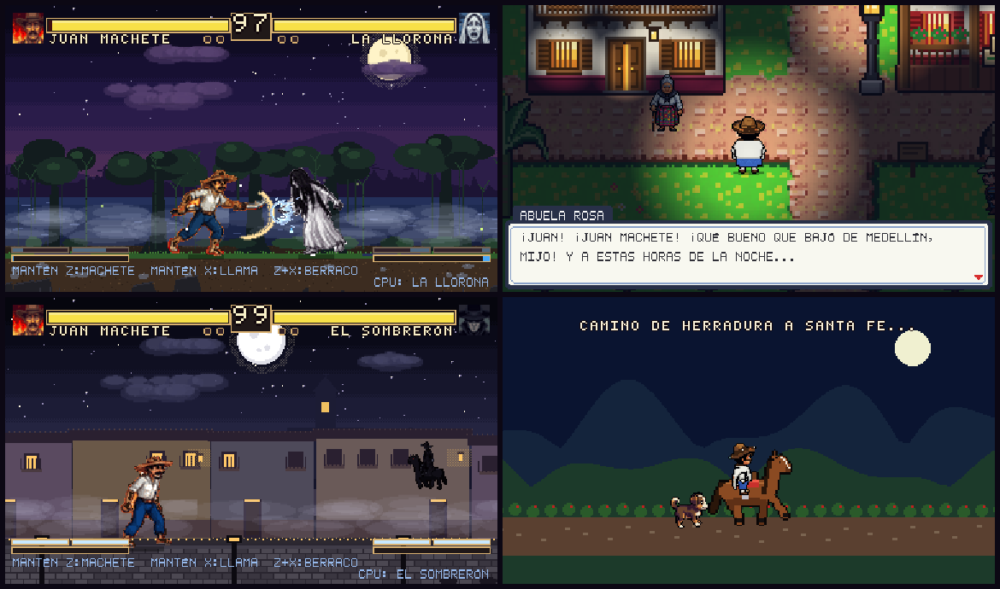

Juego de lucha 2D en pixel art inspirado en las leyendas colombianas, con un **modo aventura** por casillas a la
manera de los juegos de bolsillo. Juan Machete, un campesino paisa de carne y hueso, recorre la vereda San Agustín,
Medellín y Santa Fe de Antioquia buscando a los mitos que andan sueltos: la Llorona, el Silbón, la Patasola, el
Sombrerón, la Madremonte, el Mohán, la Muelona, el Hombre Caimán y Bachué. Cuando uno aparece, la pantalla cambia
a un combate al estilo Mortal Kombat.

**Juégalo en el navegador:** https://mitos-de-colombia.vercel.app

Hecho con Phaser 3, TypeScript y Vite. Resolución interna 384 × 224 con escalado entero y sin suavizado.

## Capturas

| | |
|---|---|
| 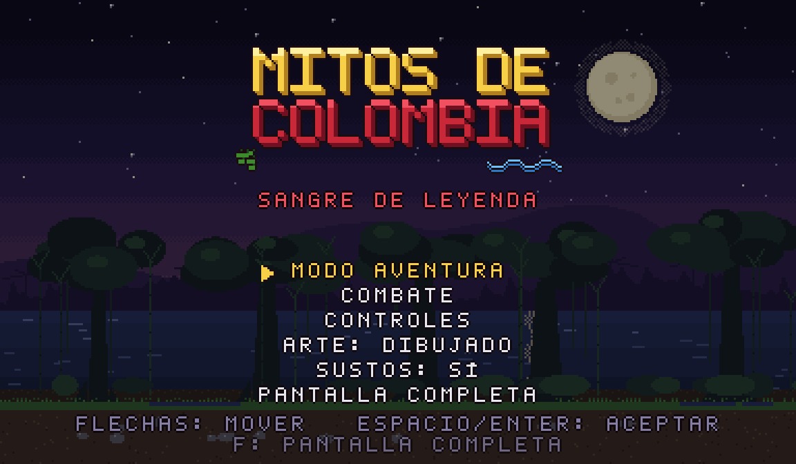 **Menú principal** | 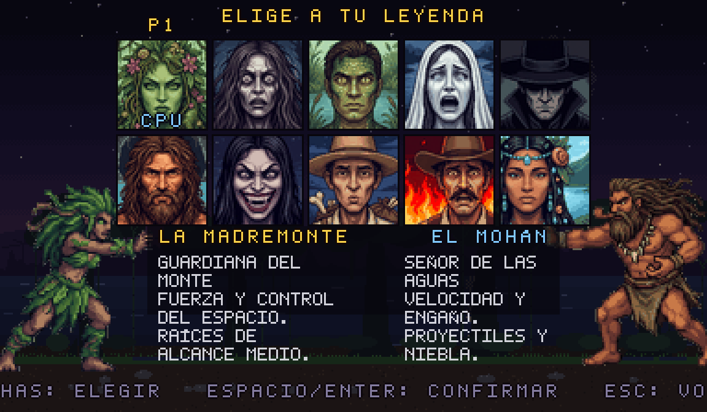 **Diez leyendas para elegir** |
| 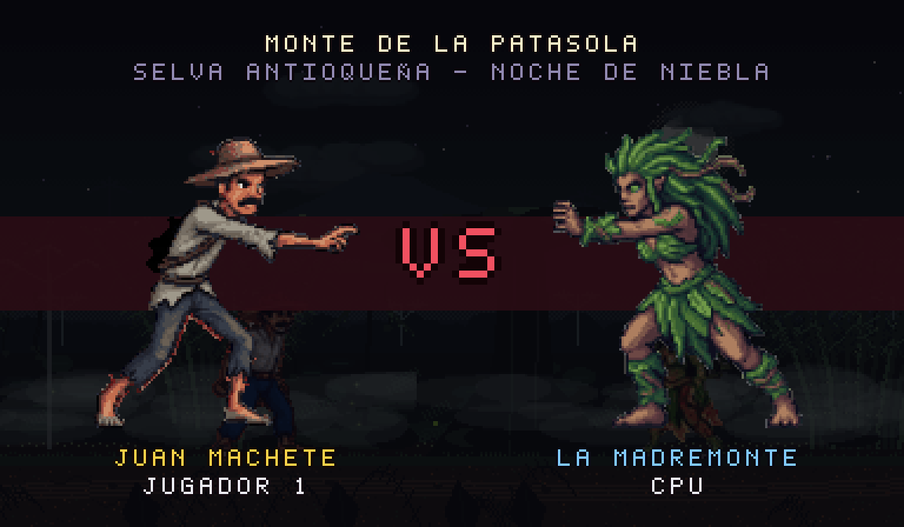 **Presentación antes de pelear** | 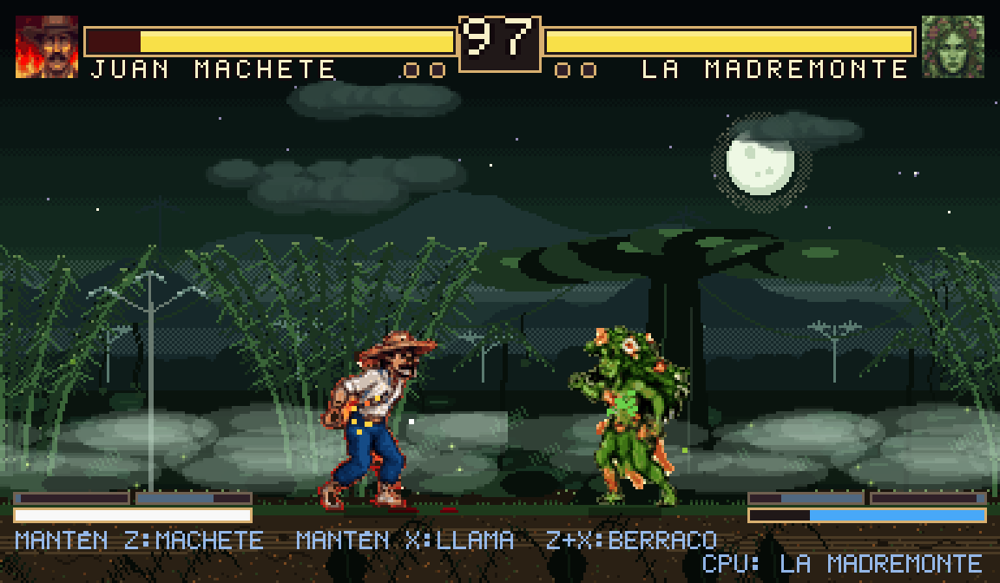 **Combate con arte dibujado** |
| 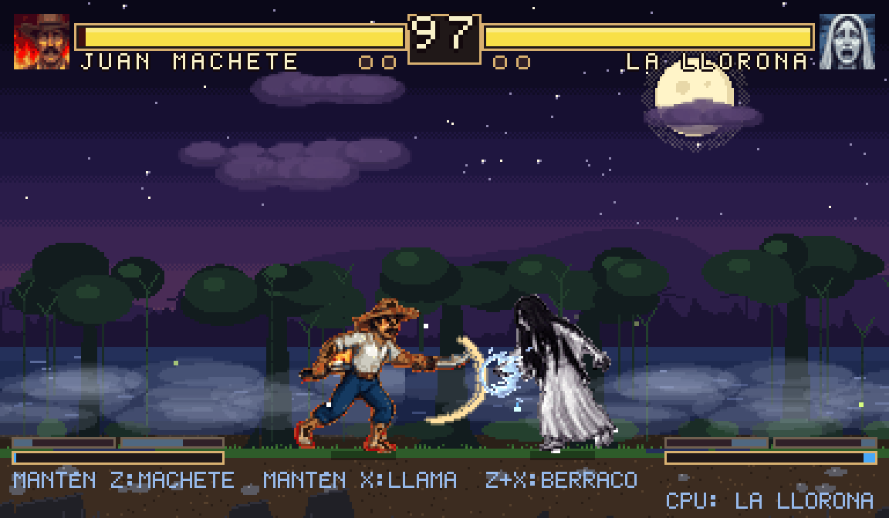 **Poderes con efectos y sonido propios** | 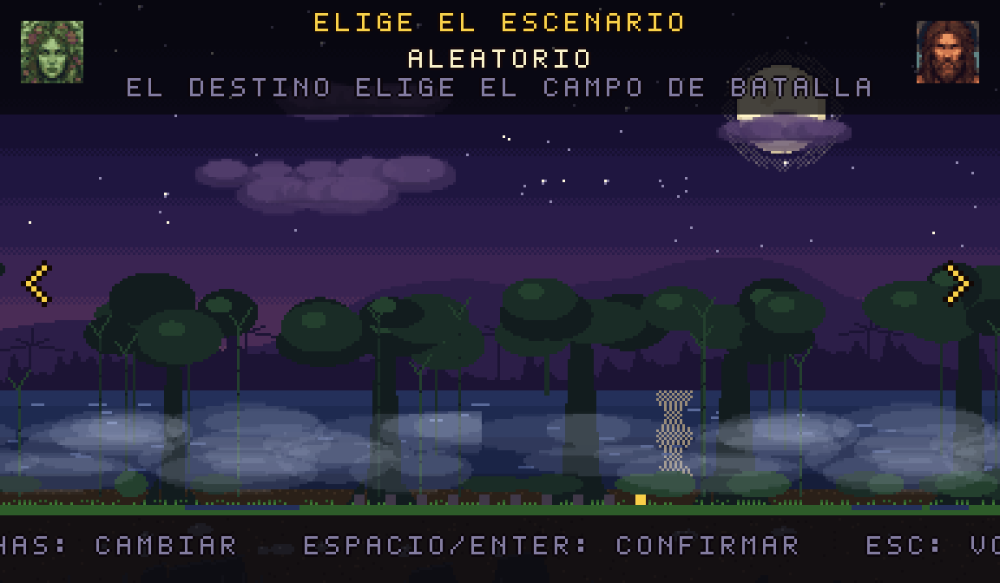 **Nueve escenarios** |
| 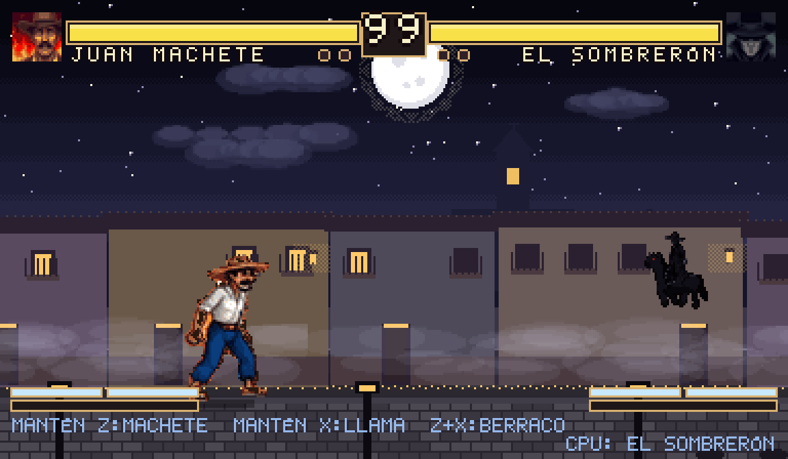 **El Sombrerón galopa al fondo del escenario** | 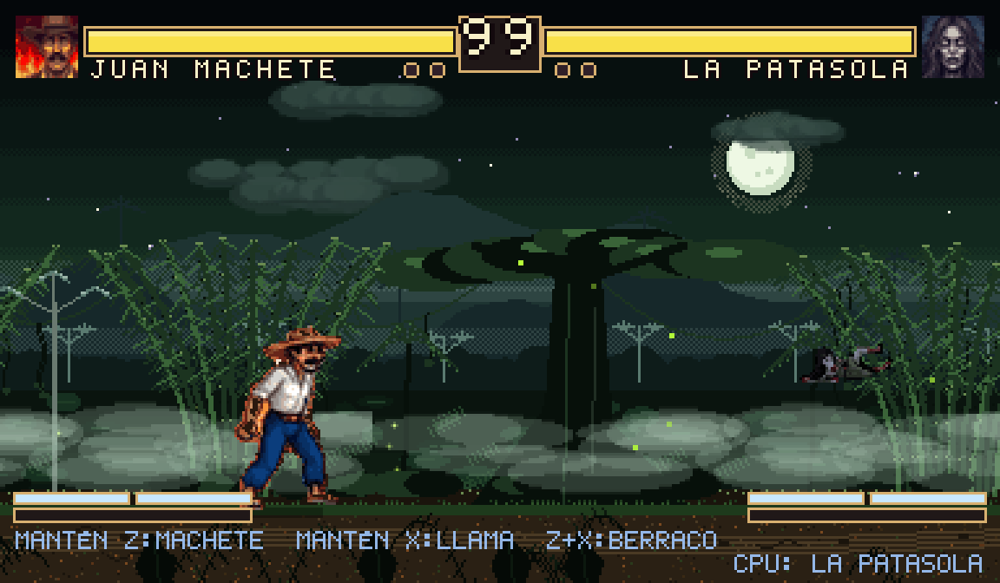 **La Patasola se acuesta en el monte** |
| 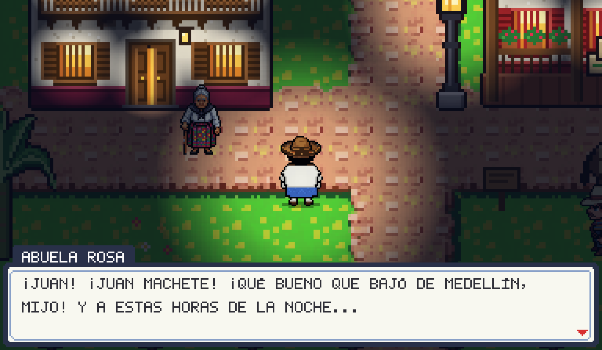 **La abuela Rosa le cuenta a Juan lo que pasa** | 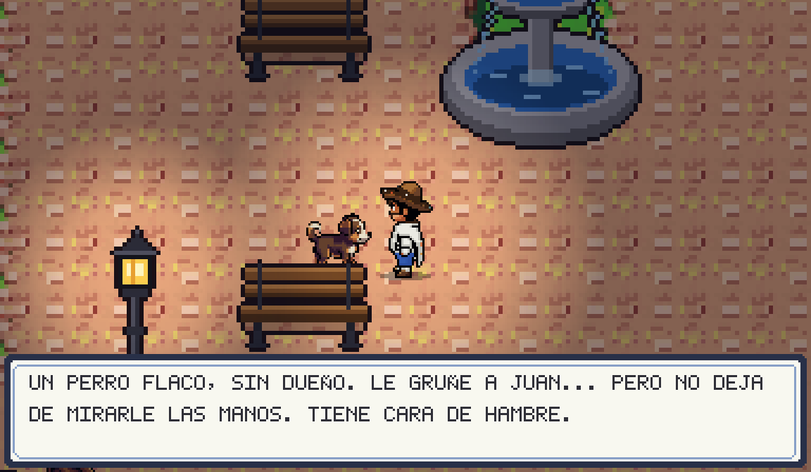 **Firulais, el perro que Juan se gana con una arepa** |
| 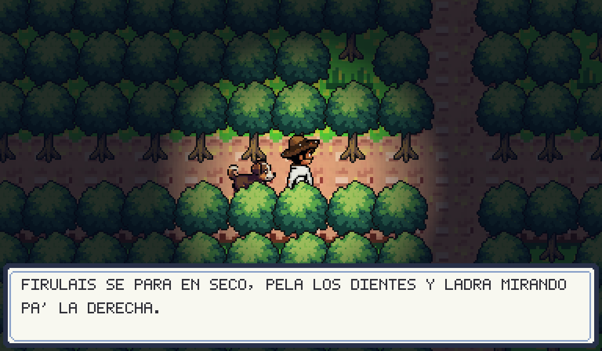 **Firulais avisa cuando hay un espanto cerca** | 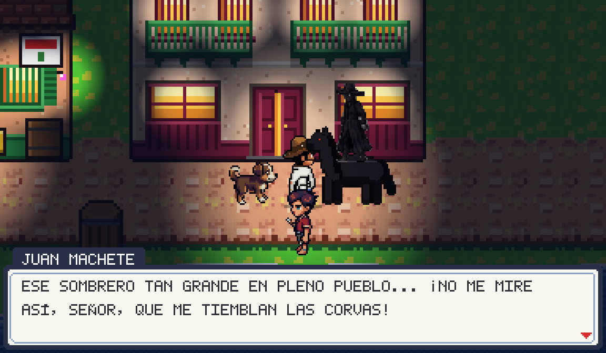 **El Sombrerón sale de la nada en su caballo negro** |
| 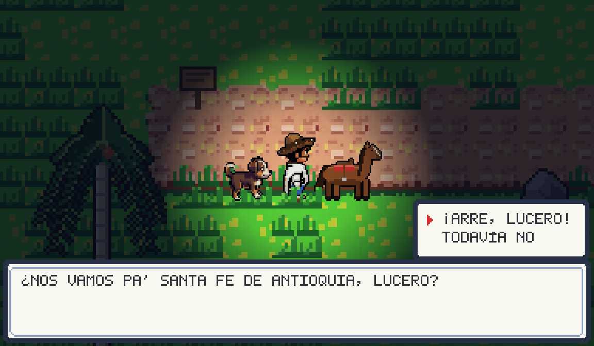 **Lucero, el caballo que se gana Juan** | 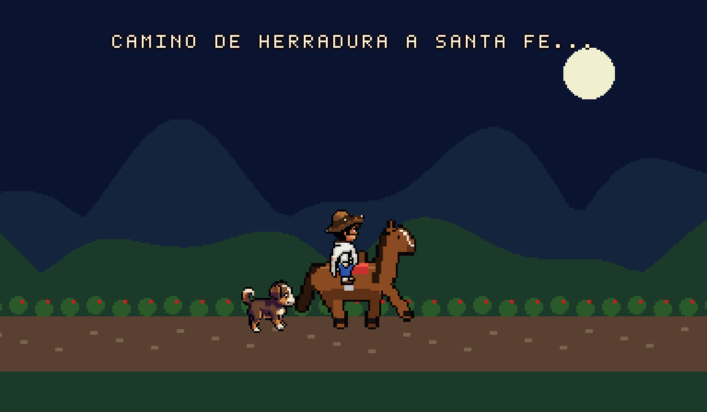 **Camino de herradura a Santa Fe** |
| 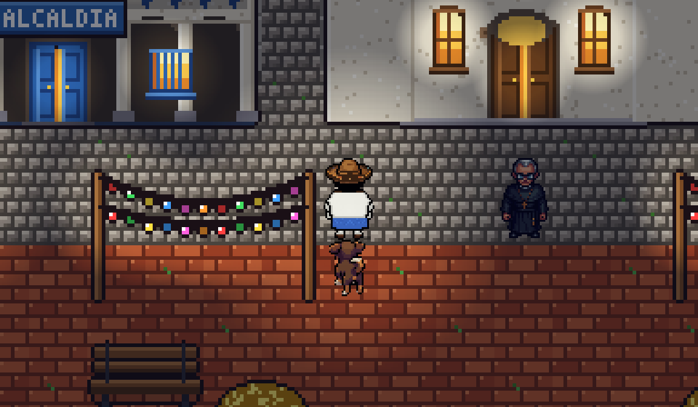 **Santa Fe de Antioquia** | 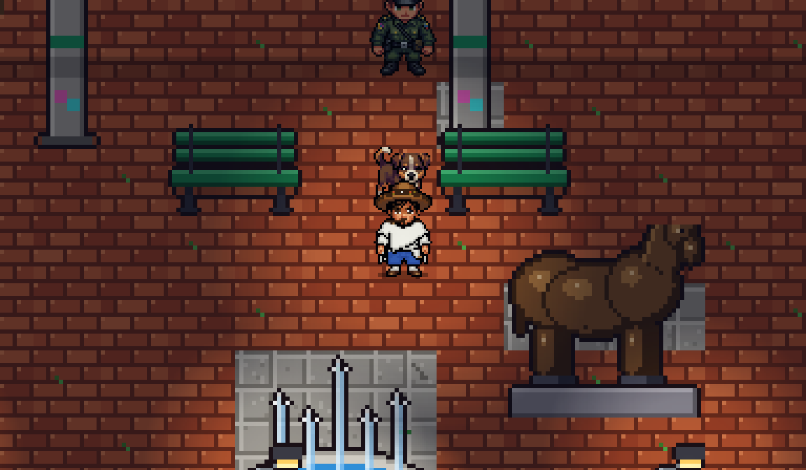 **Medellín: Plaza Botero** |
| 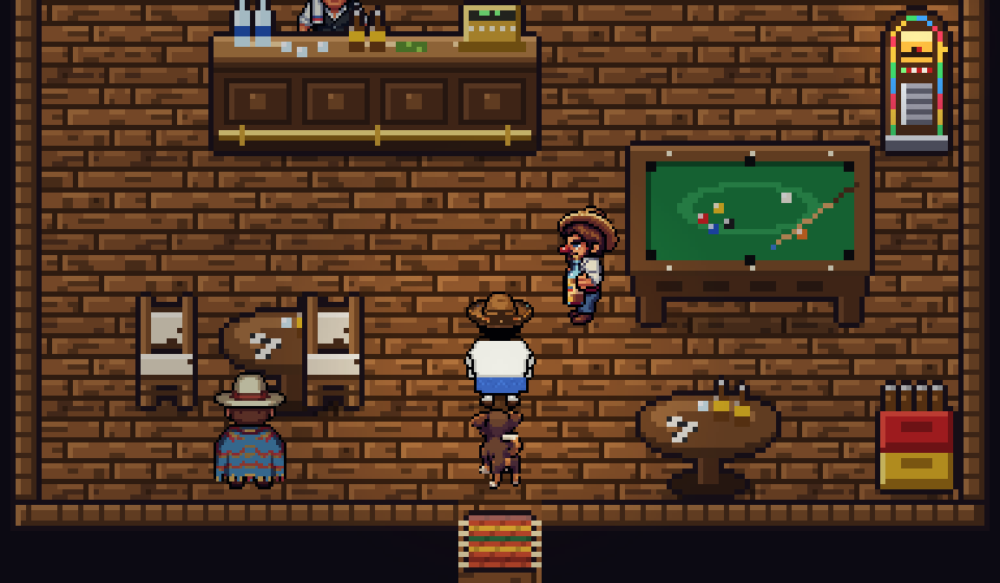 **Interiores: la cantina La Última Lágrima** | |

## Lo que trae

- **Modo aventura** con tres lugares para recorrer (San Agustín, Medellín y Santa Fe de Antioquia), 32 interiores,
  más de 40 personajes con quienes hablar y 27 historias de la tradición colombiana para escuchar.
- **Mitos escondidos**: no se ven en el mapa; dejan señales (huesos, lágrimas, huellas de una sola pata), se oyen
  de lejos y saltan encima de Juan. Si uno se escapa, toca volverlo a buscar.
- **Compañeros que se ganan**: Firulais, el perro de la plaza, que ladra cuando hay peligro, y Lucero, el caballo
  de don Rubén, con el que Juan viaja a Santa Fe de Antioquia.
- **Combate de lucha** uno contra uno, al mejor de tres rondas, con 10 personajes, 2 poderes y un definitivo cada
  uno, remate final ("¡ACÁBALO!") y una IA con tres dificultades.
- **Controles para niños**: solo dos botones, golpe y patada. Los golpes fuertes, los poderes y el definitivo salen
  por combinaciones.
- **Los mitos se meten al fondo del escenario** y hacen cosas raras allá (se hunden en el río, se arrastran por
  la ciénaga, se acercan sin moverse...) antes de volver a atacar.
- **Terror**: sustos con la cara del mito, latido que se acelera con la tensión y sonido propio de cada escenario.
  Se pueden desactivar en el menú.
- **Sonido**: cada poder tiene su sonido declarado con grabaciones reales, Juan Machete tiene su propia voz y al
  entrar en combate cambia la música, como en los juegos de bolsillo.

## Documentación

| Documento | Contenido |
|---|---|
| [Modo aventura](docs/AVENTURA.md) | Historia, mapas, mitos escondidos, perro, caballo, viajes e historias |
| [Combate](docs/COMBATE.md) | Reglas, controles, los 10 personajes y sus poderes, escenarios, escenas al fondo y terror |
| [Arte y sonido](docs/ARTE_Y_SONIDO.md) | Cómo se hizo el arte (dibujado, PixelLab, procedimental), animación, música y efectos |
| [Arquitectura](docs/ARQUITECTURA.md) | Estructura del código, decisiones técnicas, pruebas y herramientas |
| [Especificación original](SPEC.md) | El documento con el que arrancó el proyecto |

## Empezar

Requisitos: Node.js 20 o superior y [pnpm](https://pnpm.io).

```bash
pnpm install
pnpm dev        # http://localhost:5173
pnpm test       # pruebas (Vitest)
pnpm build      # revisión de tipos + build de producción en dist/
pnpm preview    # sirve dist/
```

## Controles

**Combate** (solo dos botones):

| Acción | Teclado | Mando |
|---|---|---|
| Moverse, saltar, agacharse | Flechas | Cruceta o palanca |
| Golpe | Z o ESPACIO | X / Y |
| Patada | X | A / B |
| Golpe fuerte / patada fuerte | Tres veces seguidas el mismo botón | |
| Poder 1 | Mantener Z y soltar, o Z X Z | |
| Poder 2 | Mantener X y soltar, o X Z X | |
| Definitivo (con la barra llena) | Z + X juntos | |
| Bloquear | Retroceder cuando el rival ataca | |

**Mapa del modo aventura**: flechas para andar, ESPACIO o ENTER para hablar y aceptar, ESC para el menú
(espantos que faltan, guardar, salir).

**Siempre**: ENTER pausa el combate, F pone pantalla completa y H muestra las cajas de golpe.

## Despliegue

Publicado en Vercel (`vercel.json`). Para volver a publicar:

```bash
vercel deploy --prod
```

`images/`, `docs/` y `tests/` no se suben a Vercel (`.vercelignore`).

## Créditos

- Diseño, dirección y arte de referencia: Raúl Alzate. Arte de los luchadores generado con Gemini a partir de
  sus indicaciones; personajes del mapa generados con [PixelLab](https://pixellab.ai).
- Sonidos grabados: paquetes CC0 de OpenGameArt (rubberduck, HaelDB, AntumDeluge, Kenney y otros). Lista completa
  en [public/assets/audio/CREDITS.md](public/assets/audio/CREDITS.md).
- Leyendas y costumbres: tradición oral colombiana.

## Licencia

- **Código**: [MIT](LICENSE). Puedes usarlo, cambiarlo y compartirlo citando al autor.
- **Sonidos grabados**: CC0 (dominio público), según cada paquete de origen en
  [public/assets/audio/CREDITS.md](public/assets/audio/CREDITS.md).
- **Arte** (`images/` y `public/assets/`): creado para este juego por el autor con ayuda de Gemini y PixelLab. Se
  incluye para que el juego funcione completo; si lo vas a reutilizar fuera de este proyecto, revisa antes los
  términos de esas herramientas.
